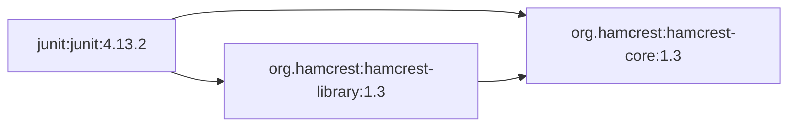
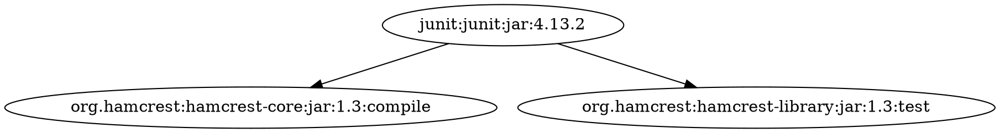
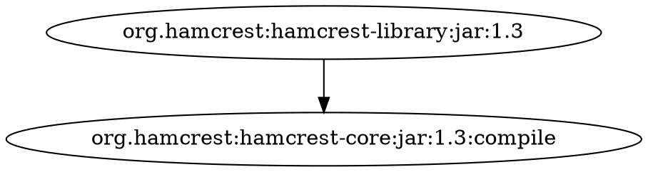
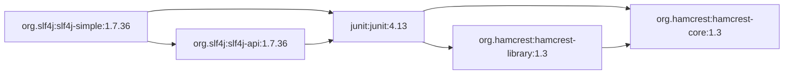
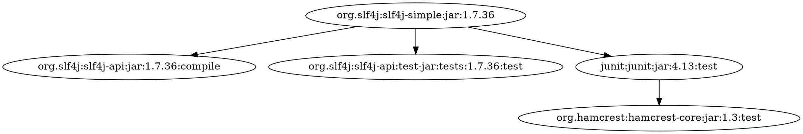

# Примеры Mermaid и сравнение с Maven

Эталон: Apache Maven 3.9.11 (3e54c93a704957b63ee3494413a2b544fd3d825b); Maven Dependency Plugin 3.8.1, `dependency:tree -DoutputType=dot`.

Для сравнения координаты нормализованы к G:A:V. Тип, classifier и scope опущены; варианты с одинаковыми G:A:V объединены. Исходный DOT приведён для проверки.

## junit:junit:4.13.2

Наш граф: узлы — 3, рёбра — 3. Maven DOT: исходные рёбра — 2, после нормализации G:A:V — 2.

Только в нашем графе:
- `org.hamcrest:hamcrest-library:1.3 -> org.hamcrest:hamcrest-core:1.3`

Только в Maven DOT:
- Нет.

Связь hamcrest-library -> hamcrest-core повторяет уже выбранную зависимость. В обычном дереве Maven это повторное ребро опущено, а в полном графе объявленных зависимостей оно сохранено.

Штатный DOT Maven:

## org.hamcrest:hamcrest-library:1.3

Наш граф: узлы — 2, рёбра — 1. Maven DOT: исходные рёбра — 1, после нормализации G:A:V — 1.

Только в нашем графе:
- Нет.

Только в Maven DOT:
- Нет.

Множества рёбер совпадают.

Штатный DOT Maven:

## org.slf4j:slf4j-simple:1.7.36

Наш граф: узлы — 5, рёбра — 6. Maven DOT: исходные рёбра — 4, после нормализации G:A:V — 3.

Только в нашем графе:
- `junit:junit:4.13 -> org.hamcrest:hamcrest-library:1.3`
- `org.hamcrest:hamcrest-library:1.3 -> org.hamcrest:hamcrest-core:1.3`
- `org.slf4j:slf4j-api:1.7.36 -> junit:junit:4.13`

Только в Maven DOT:
- Нет.

Связи junit -> hamcrest-library и slf4j-api -> junit имеют scope=test в POM этих пакетов и не передаются транзитивно Maven. Наш анализ всех scopes сохраняет их и дополнительное ребро hamcrest-library -> hamcrest-core. Maven также различает slf4j-api.jar и test-jar с classifier=tests; наш идентификатор G:A:V объединяет эти варианты. Полные подписи видны в DOT ниже.

Штатный DOT Maven:

